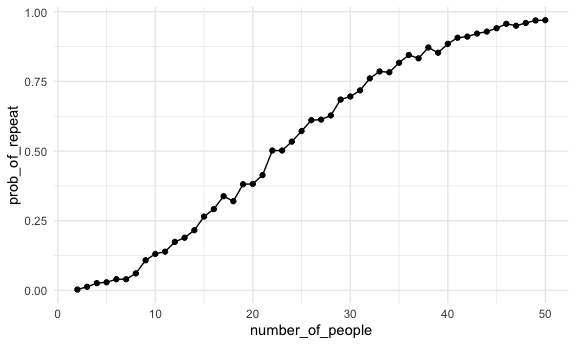
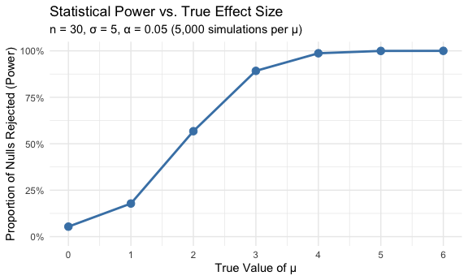
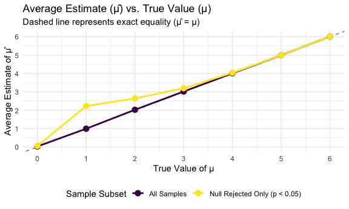

P8105 Homework 5
================
Jia Varkey
2026-11-11

## Problem 1

Suppose you put 𝑛 people in a room, and want to know the probability
that at least two people share a birthday. For simplicity, we’ll assume
there are no leap years (i.e. there are only 365 days) and that
birthdays are uniformly distributed over the year (which is actually not
the case).

Write a function that, for a fixed group size, randomly draws
“birthdays” for each person; checks whether there are duplicate
birthdays in the group; and returns TRUE or FALSE based on the result.

``` r
birthday_repeated = function(n_room) {
  birthdays = sample(1:365, size = n_room, replace = TRUE)
  
  repeated_birthdays = length(unique(birthdays)) < n_room
  
  return(repeated_birthdays) 
}
```

Next, run this function 10000 times for each group size between 2 and
50. For each group size, compute the probability that at least two
people in the group will share a birthday by averaging across the 10000
simulation runs. Make a plot showing the probability as a function of
group size, and comment on your results.

``` r
birthday_results_df =
  expand_grid(
    number_of_people = 2:50,
    iter = 1:1000
  ) |>
  mutate(
    repeated = map_lgl(number_of_people, birthday_repeated)
  )
```

``` r
birthday_results_df |>
  group_by(number_of_people) |>
  summarize(prob_of_repeat = mean(repeated)) |>
  ggplot(aes(x = number_of_people, y = prob_of_repeat)) +
  geom_point() +
  geom_line()
```



In a room of just about 23 people, the simulated probability converges
to roughly 50%, which is suprisingly lower than expected.

## Problem 2

This zip file contains data from a longitudinal study that included a
control arm and an experimental arm. Data for each participant is
included in a separate file, and file names include the subject ID and
arm.

Create a tidy dataframe containing data from all participants, including
the subject ID, arm, and observations over time:

Start with a dataframe containing all file names; the list.files
function will help Iterate over file names and read in data for each
subject using purrr::map and saving the result as a new variable in the
dataframe Tidy the result; manipulate file names to include control arm
and subject ID, make sure weekly observations are “tidy”, and do any
other tidying that’s necessary

Make a spaghetti plot showing observations on each subject over time,
and comment on differences between groups.

## Problem 3

When designing an experiment or analysis, a common question is whether
it is likely that a true effect will be detected – put differently,
whether a false null hypothesis will be rejected. The probability that a
false null hypothesis is rejected is referred to as power, and it
depends on several factors, including: the sample size; the effect size;
and the error variance. In this problem, you will conduct a simulation
to explore power in a one-sample t-test.

First set the following design elements:

Fix 𝑛=30 Fix 𝜎=5 Set 𝜇=0. Generate 5000 datasets from the model

𝑥∼𝑁𝑜𝑟𝑚𝑎𝑙\[𝜇,𝜎\] For each dataset, save 𝜇̂ and the p-value arising from a
test of 𝐻:𝜇=0 using 𝛼=0.05. Repeat the above for 𝜇={1,2,3,4,5,6}

``` r
t_test_power <- function(mu, n = 30, sigma = 5) {
  x = rnorm(n = n, mean = mu, sd = sigma)
  
  t.test(x, mu = 0) |>
    broom::tidy() |>
    select(mu_hat = estimate, p.value)
}

power_results = expand_grid(
  mu = 0:6,
  iter = 1:5000
  ) |>
  mutate(test_res = map(mu, t_test_power)) |>
  unnest(test_res) |>
  mutate(rejected = p.value < 0.05)


summary_df = power_results |>
  group_by(mu) |>
  summarize(
    power = mean(rejected),
    mean_mu_all = mean(mu_hat),
    mean_mu_rejected = mean(mu_hat[rejected])
  )

summary_df
```

    ## # A tibble: 7 × 4
    ##      mu  power mean_mu_all mean_mu_rejected
    ##   <int>  <dbl>       <dbl>            <dbl>
    ## 1     0 0.0538      0.0281           0.0601
    ## 2     1 0.178       0.991            2.23  
    ## 3     2 0.568       2.02             2.64  
    ## 4     3 0.892       3.02             3.20  
    ## 5     4 0.987       4.01             4.04  
    ## 6     5 1.000       4.99             5.00  
    ## 7     6 1           6.01             6.01

Make a plot showing the proportion of times the null was rejected (the
power of the test) on the y axis and the true value of 𝜇 on the x axis.
Describe the association between effect size and power.

``` r
plot_power = ggplot(summary_df, aes(x = mu, y = power)) +
  geom_line(color = "steelblue", linewidth = 1) +
  geom_point(color = "steelblue", size = 3) +
  scale_x_continuous(breaks = 0:6) +
  scale_y_continuous(limits = c(0, 1), labels = scales::percent_format()) +
  labs(
    title = "Statistical Power vs. True Effect Size",
    subtitle = "n = 30, σ = 5, α = 0.05 (5,000 simulations per μ)",
    x = "True Value of μ",
    y = "Proportion of Nulls Rejected (Power)"
  ) +
  theme_minimal()

plot_power
```



Make a plot showing the average estimate of 𝜇̂ on the y axis and the true
value of 𝜇 on the x axis.Overlay the average estimate of 𝜇̂ only in
samples for which the null was rejected on the y axis and the true value
of 𝜇 on the x axis. Is the sample average of 𝜇̂ across tests for which
the null is rejected approximately equal to the true value of 𝜇? Why or
why not?

``` r
plot_estimates = summary_df |>
  pivot_longer(
    cols = c(mean_mu_all, mean_mu_rejected),
    names_to = "sample_group",
    values_to = "avg_mu_hat"
  ) |>
  mutate(
    sample_group = recode(
      sample_group,
      "mean_mu_all" = "All Samples",
      "mean_mu_rejected" = "Null Rejected Only (p < 0.05)"
    )
  ) |>
  ggplot(aes(x = mu, y = avg_mu_hat, color = sample_group)) +
  geom_abline(slope = 1, intercept = 0, linetype = "dashed", color = "gray50") +
  geom_line(linewidth = 1) +
  geom_point(size = 3) +
  scale_x_continuous(breaks = 0:6) +
  scale_y_continuous(breaks = 0:6) +
  labs(
    title = "Average Estimate (μ̂) vs. True Value (μ)",
    subtitle = "Dashed line represents exact equality (μ̂ = μ)",
    x = "True Value of μ",
    y = "Average Estimate of μ̂",
    color = "Sample Subset"
  ) +
  theme_minimal() +
  theme(legend.position = "bottom")

plot_estimates
```


